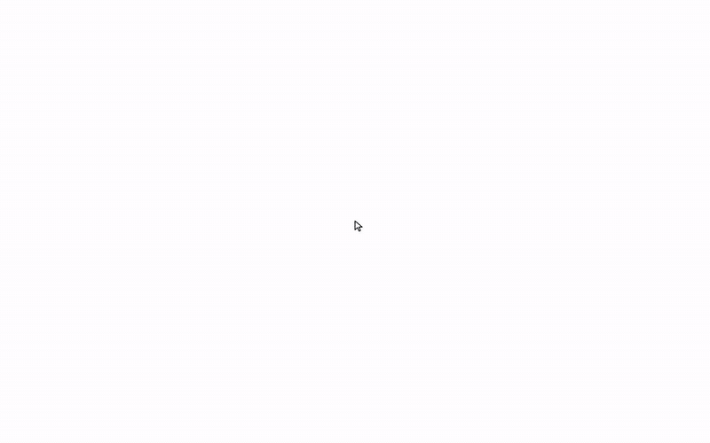

# notesmap

Research-programme notes, written in LaTeX, shown as a live world map (or a
board). Each programme is a panel at its place on the map, with a lead line,
an image and a row of paper cards; click a card to unfold its note.
Cross-references become arrows captioned by the sentence that makes them. The
same `.tex` builds as a PDF, and every open map updates within seconds of an edit.

Built on [danvas](https://github.com/DanielChahine004/danvas).

[](demo/notesmap-demo.mp4)

*Download the template folder, open it on the notesmap page, edit `main.tex` and save: the map follows. (The folder dialog and the editor are drawn into the recording; the edits are real saves.) [Full-quality video](demo/notesmap-demo.mp4).*

## Start here (no coding)

There are two ways in: the notesmap page, with nothing to install, or this
repository on your own computer, for the code and everything else.

### In the browser: point the page at a folder

1. **Get a notes folder** holding `main.tex`, `notesmap.sty` and the pictures
   in `img/`:
   - **New notes:** download [the template folder](https://raw.githubusercontent.com/DanielChahine004/notesmap/main/notesmap-notes.zip)
     and unzip it. Its `main.tex` shows one of everything the notes can hold
     (a programme with a picture, a paper with one, an arrow between
     programmes, a conference with a deadline, a loose paper), ready to
     replace with your own.
   - **Notes in Overleaf:** **Menu → Download → Source**, and unzip it.
     ([Start in Overleaf](https://www.overleaf.com/docs?zip_uri=https://raw.githubusercontent.com/DanielChahine004/notesmap/main/notesmap-notes.zip)
     makes a new Overleaf project from the template.)
2. Open [the notesmap page](https://danielchahine004.github.io/danvas/?local=DanielChahine004/notesmap)
   and **choose that folder** (or drop it on the page). The first visit takes
   a little while to load Python into the page.
3. **Edit and save `main.tex`:** in Chrome or Edge the map follows every save,
   and the page offers to reopen the same folder next time. In Firefox or
   Safari, or after downloading a newer source from Overleaf, drop the folder
   on the map again.

The files are read by that browser tab and never uploaded. Pictures must be
PNG or JPEG.

### On your computer: the repository

For the command line, the board view, checks, a bibliography cross-check and
the rest, clone this repository (or **Code → Download ZIP**). It also works
offline. Without coding:

1. On GitHub, click **Code → Download ZIP**, and unzip it somewhere you keep work.
2. Double-click **`Start notesmap.bat`** (Windows) or **`Start notesmap.command`**
   (Mac). On Linux, run `start-notesmap.sh`.
3. The first time, it downloads what it needs (a few minutes, needs the
   internet). The map then opens in your browser and the `notes` folder opens
   beside it. Later starts take a couple of seconds.
4. Open `notes/main.tex` in any text editor and save: the map updates within
   seconds. To start from notes you already have, replace `notes/main.tex`
   with yours (keep the name) and put its images in `notes/img/`.

Keep the black window open while you use the map; close it to stop. Nothing is
installed on your computer: everything downloaded stays in this folder's
`.notesmap` and `.venv` folders, and deleting the folder removes it all.

Windows may warn that the file comes from the internet: choose **More info →
Run anyway**. A Mac may refuse to open it: open **System Settings → Privacy &
Security** and click **Open Anyway**, then double-click it again.

## Quick start (command line)

Install [uv](https://docs.astral.sh/uv/), which brings Python with it
(Windows: `winget install astral-sh.uv`; macOS/Linux:
`curl -LsSf https://astral.sh/uv/install.sh | sh`). Then:

```
uv tool install git+https://github.com/DanielChahine004/notesmap
notesmap init notes        # notes/main.tex, notes/notesmap.sty, ./notesmap.toml
notesmap serve --map       # opens the map; edit notes/main.tex and watch it update
notesmap check             # missing images, dangling refs, unplaced programmes
```

`check --gaps` also lists unfinished notes; `--strict` exits non-zero on a
problem, for CI.

## Writing notes

```latex
\usepackage{notesmap}

\begin{programnote}{Group -- what they build}{GroupKey}
\location{51.05}{3.72}{Ghent, Belgium}   % the pin; [dx,dy] fixes the panel's offset
\thumb{img/group.png}
\paragraph{What it is}                   % becomes the lead line
...
\paragraph{Why it matters here}
Shares a detector with \ref{prog:OtherKey}.   % an arrow, captioned by this sentence

\begin{papernote}{Author et al.\ 2023 -- Title}{Author2023}   % the year orders the cards
Journal 1:2, \doi{10.xxxx/yyyy}.                               % the card's link
\paragraph{Summary}
... \gap{still to check}
\end{papernote}
\end{programnote}

\begin{confnote}{IEEE NSS/MIC 2027 -- Pasadena}{NSSMIC2027}   % a conference panel
\location{34.15}{-118.14}{Pasadena, USA}
\dates{2027-10-30}{2027-11-06}
\deadline[abstracts]{2027-05-12T23:59:59+02:00}               % counts down live
\end{confnote}
```

Put each `\begin` and `\end` on its own line. The text before ` -- ` is the
name a `\ref` shows. Panels without an offset are placed near their pin,
keeping leaders from crossing. On the map, drag a panel's corner square to
move it and its bottom-right grip to resize it.

## With Zotero

Use each paper's Zotero citation key as its note key, then point notesmap at
what Zotero keeps on disk:

```toml
[check]
bib = "library.bib"       # Better BibTeX export with "Keep updated" ticked
[pdfs]
dir = "papers"            # where ZotMoov files PDFs, renamed to {{ citationKey }}
url = "https://github.com/you/papers/blob/main/{key}.pdf"
```

`check` then flags a note whose DOI Zotero holds under another key, and each
card links to its PDF. Keeping `papers/` in a private git repo puts the PDFs
online without Zotero's storage limit.

## Public maps

The PDF keeps everything; the map can leave your own working out. Under
`[publish]`: `hide_sections` drops `\paragraph`s by heading (e.g. "why it
matters"), `hide_gaps` drops `\gap{}`, `hide_programmes` drops whole
programmes. `\aside{...}` marks a single sentence to keep off the map. An arrow
survives only if a shown sentence still makes the reference.

## Publishing the map without a server

The map can be a link instead of a running `notesmap serve`: danvas's static
page builds it in each reader's browser from the notes in your repository, and
redraws within a minute of a push. Add a `danvas.toml` beside `notesmap.toml`:

```toml
[app]
entry = "notesmap.static:app"
requires = ["github:DanielChahine004/notesmap@main"]   # this repo; pin a tag or commit to hold a version
files = ["notesmap.toml"]                              # notesmap reads the rest from it
```

and open `https://danielchahine004.github.io/danvas/?repo=you/your-notes`. To run
a copy of notesmap you have changed, keep it in your repository and replace
`requires` with `paths = ["path/to/notesmap/src"]`. Each reader sees their own
copy of the board (what they draw stays in their browser), and the companion
editor link is dropped when it points at your own machine. A private repository
needs a GitHub token for now; see danvas's
[web/README.md](https://github.com/DanielChahine004/danvas/blob/main/web/README.md).

## Sharing and editing

- **Split the notes.** `\input{programmes/ghent}` per programme; notesmap
  follows `\input`, so people editing different programmes never collide.
- **Shared storage.** `[source] path` takes a local path (a checkout, Dropbox,
  a synced bucket) or an http(s) URL. Changes are read only once they settle
  and parse; a `.lock` file beside `main.tex` holds the last good version.
- **Live co-editing.** JupyterLab with `jupyter-collaboration` writes every
  keystroke to the file the map watches. Set `[server] edit_url` to link it
  from the map. It saves with LF line endings.

## Configuration

Everything lives in `notesmap.toml`; `notesmap init` writes an annotated copy.

| Section | Controls |
|---|---|
| `[source]` | where the notes are, polling, lock files, a custom parser |
| `[latex]` | environment names, the lead-line heading, your macros and plugins |
| `[board]` | row order, links not to draw, the shelf for loose papers |
| `[publish]` | what the map leaves out |
| `[check]` | the bibliography to cross-check |
| `[pdfs]` | folder of `<key>.pdf` and the URL a card links to |
| `[claims]` | annotation files and a viewer URL: `\claim{Key/id}` after a sentence links it to the quote that backs it ([paperstore](https://github.com/DanielChahine004/paperstore)), and `check` fails on one that is missing; `figures` (a folder of `<Key>/<id>.png`, e.g. a paperstore's `figures/`) lets `\claimfig{Key/id}` show a box annotation's picture with its label and page |
| `[map]` | the map image (any equirectangular image) and its width |
| `[tables.<Key>]` | turns a programme's tabulars into a sortable table panel, or a radar (`view = "radar"` or `"detectors"`) |
| `[server]` | port and the companion editor link |

**Macros:** `[latex.macros]` takes templates (`kg = "{1} kg"`); for anything
more, a plugin module with `register(converter)`.

**Not LaTeX?** `[source] parser = "mynotes:parse"` points at a Python function
that returns the notes; `examples/markdown/` is a working one.

Table and radar panels, custom parsers and scripted board checks are in
[docs/advanced.md](docs/advanced.md).

## Citing and licence

MIT (`LICENSE`); `CITATION.cff` has the citation. notesmap depends on danvas,
which is AGPL-3.0, so serving the map to others over a network brings danvas's
terms into play.
